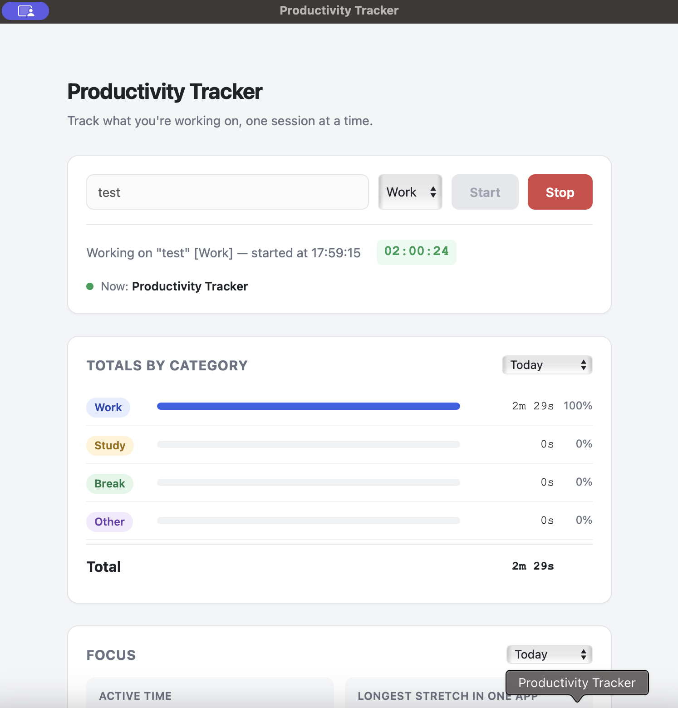
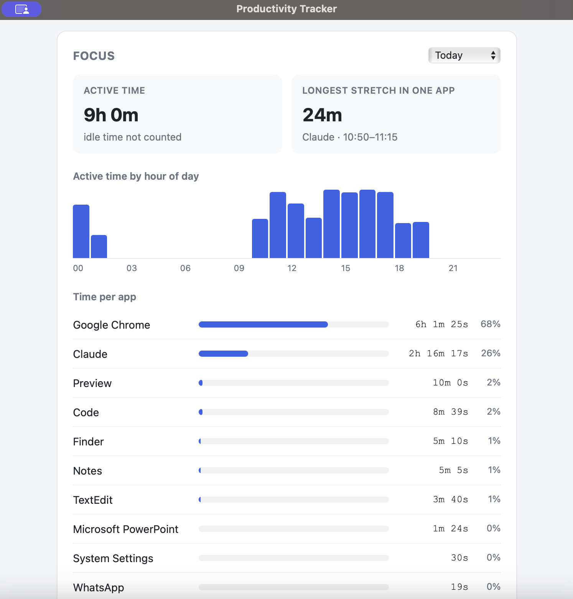
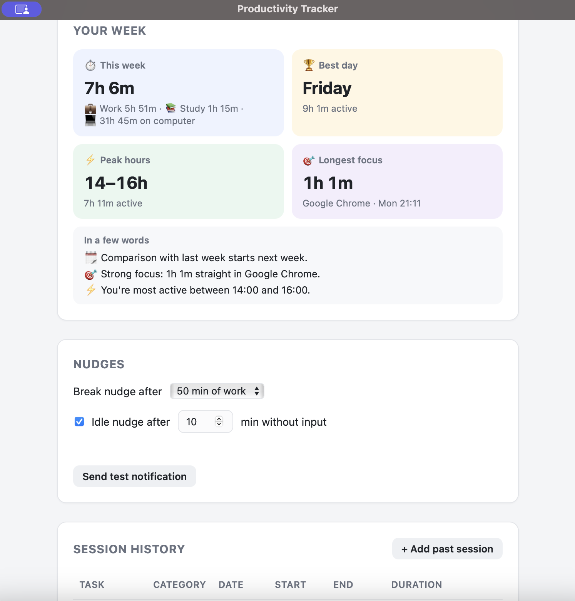

# Productivity Tracker

A macOS desktop app that tracks time on tasks and which apps you use, and shows where your time went.

| Timer and totals | Focus view | Weekly overview |
|---|---|---|
|  |  |  |

## Features

- **Session timer** – start and stop a timer for a task in one of four categories (Work, Study, Break, Other). A running timer keeps counting if the app is closed and reopened.
- **Session history** – edit, delete, or add past sessions (e.g. time spent away from the computer).
- **Totals by category** – today, this week, this month, all time, or a custom date range, with a bar per category.
- **Automatic tracking** – records which app is in front every 5 seconds. Time with no keyboard or mouse input for 5 minutes, or with the screen locked, is not counted.
- **Focus view** – for today or this week: active time, longest unbroken stretch in one app, active time by hour of day, and time per app.
- **Weekly overview** – best day, most active two-hour window, longest focus stretch, comparison with the same point last week, and a short rule-based summary.
- **Notifications** – a break reminder after 25 or 50 minutes of active work, and a reminder when a timer is running but the computer has been idle.
- **Menu bar timer** – shows the running time and the current app; stop the timer or restart the last task from the menu bar.
- **Local only** – all data is stored in JSON files on the computer. The server only accepts connections from the same machine.

## Tech stack

- **Backend:** Node.js, built-in `http` module (no framework); data in JSON files
- **Frontend:** a single HTML page with vanilla JavaScript and CSS (no build step)
- **Desktop app:** Tauri 2 (Rust) – window, menu bar item, notifications; the Node server is bundled as a single executable and started by the app
- **macOS integration:** `lsappinfo` (frontmost app) and `ioreg` (time since last input)
- **Tests:** Node's built-in test runner, 240 unit tests

## Run locally

Requires macOS and Node.js (developed with Node 24 and 26).

**In a browser:**

```bash
node server.js
# open http://localhost:3000
```

**Run the tests:**

```bash
npm test
```

**Build the desktop app** (Apple silicon Mac; also needs Rust and the official Node.js installer from nodejs.org at `/usr/local/bin/node`):

```bash
npm install
npx tauri build --bundles app
# output: src-tauri/target/release/bundle/macos/Productivity Tracker.app
```

More detail: [functional.md](functional.md) (what it does) and [tech.md](tech.md) (how it works).

Built step by step as a learning project using Claude Code.
